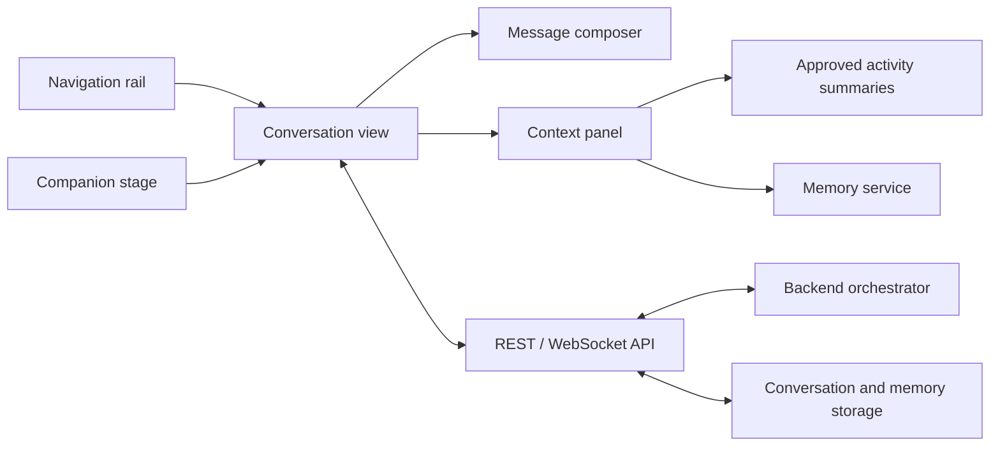
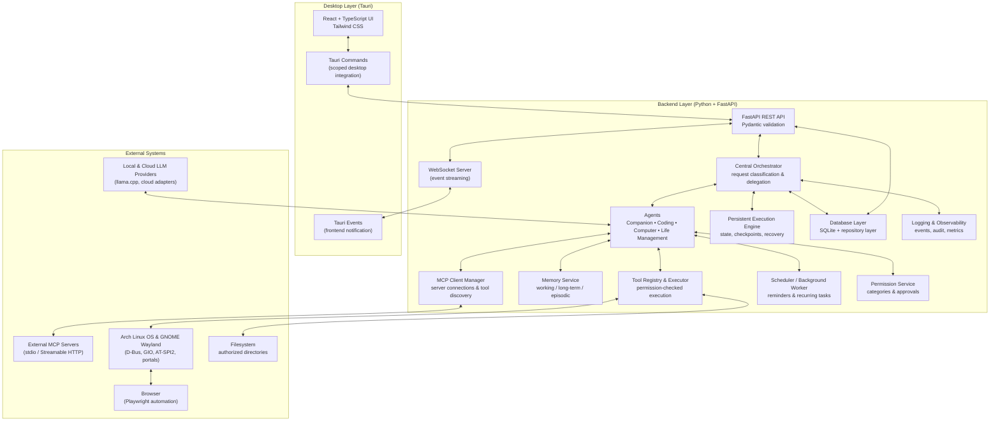
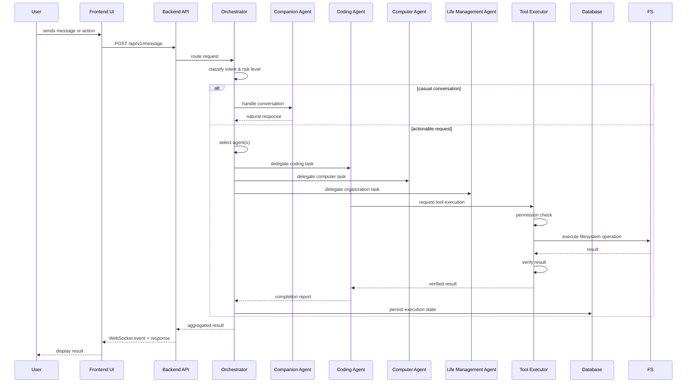
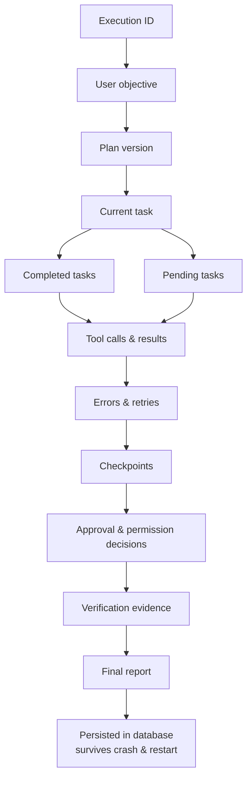
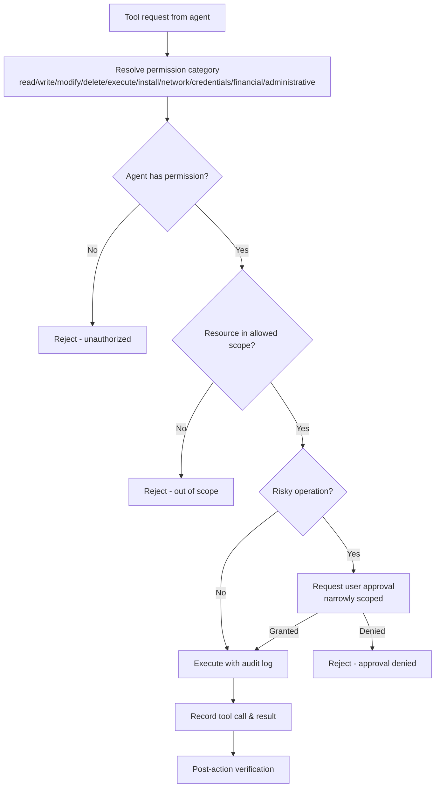
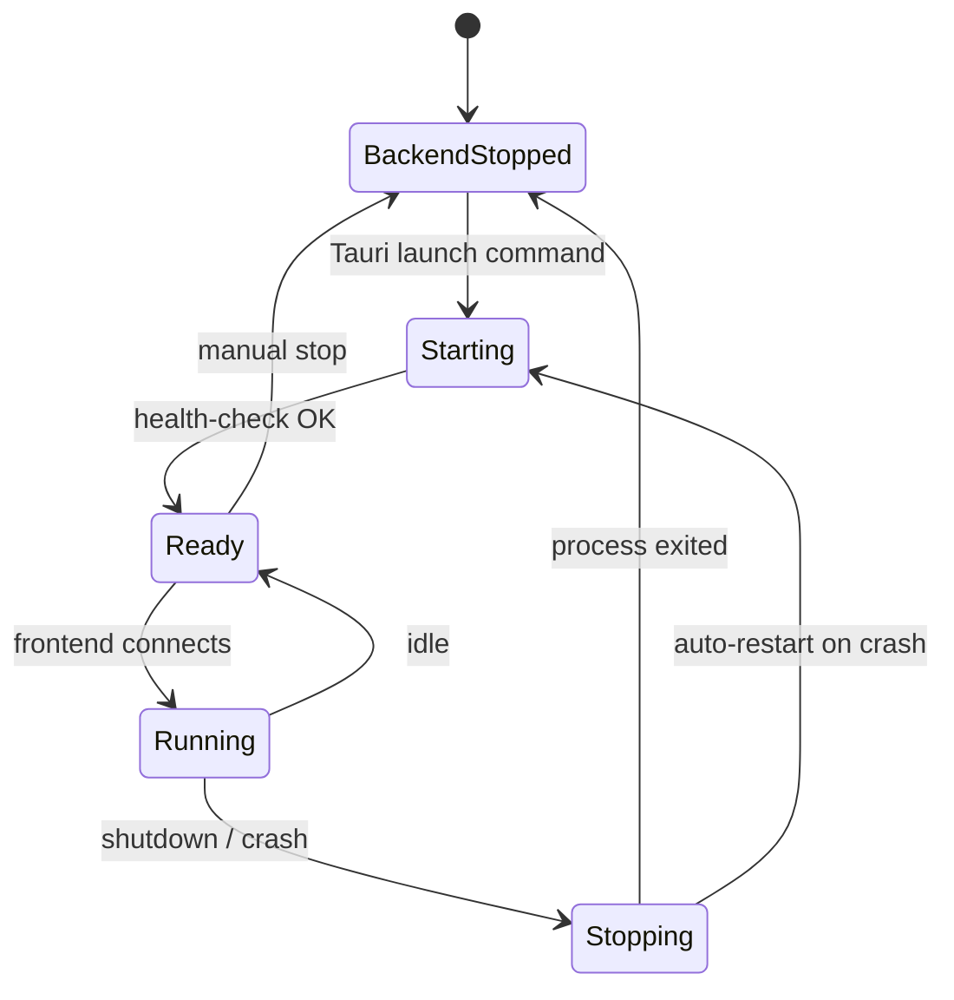

# NEXUS AI — Architecture Diagrams

**Status:** Draft — Phase 0, Step 0.2  
**Source:** NEXUS_AI_Revised_Master_Roadmap.md

## 1. Component architecture

The chat UI is a frontend composition over these services, not a separate AI execution layer:



The companion avatar is a presentation element. Agent status, messages, activity summaries, and memories must be sourced from their respective application services.



## 2. Agent interaction / orchestration flow



## 3. Data flow — user request to verified result

```mermaid
flowchart TD
    A[User input<br/>(chat, voice, command)] --> B[Frontend UI]
    B --> C[WebSocket / REST API]
    C --> D[Orchestrator]
    D --> E{Intent classification}
    E -->|Casual| F[Companion Agent<br/>natural response]
    E -->|Actionable| G[Select agent(s)<br/>Companion / Coding / Computer / Life Mgmt]
    G --> H[Build context<br/>memory + permissions]
    H --> I[Agent proposes action]
    I --> J[Permission check]
    J -->|Denied| K[Request user approval]
    J -->|Granted| L[Tool Executor]
    L --> M[Execute operation]
    M --> N[Post-action verification]
    N -->|Failed| O[Retry / replan / report error]
    N -->|Succeeded| P[Record result + verification evidence]
    P --> Q[Update execution state<br/>checkpoint persisted]
    Q --> R[Aggregate result]
    R --> S[Return to Companion]
    S --> T[WebSocket event to frontend]
    T --> U[Display to user]
```

## 4. Execution state (persistent)



## 5. Permission flow



## 6. Backend lifecycle (Tauri manages Python process)


