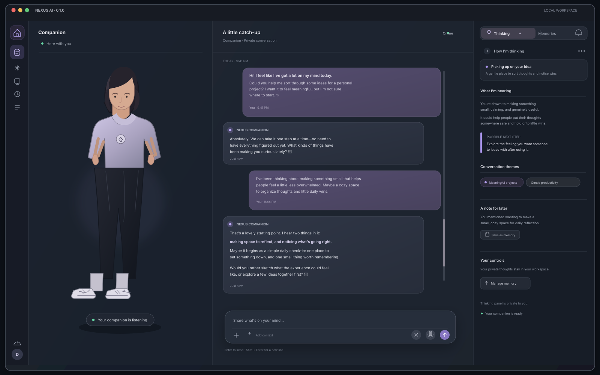

# NEXUS AI — Chat Experience and Visual Direction

**Status:** Design direction  
**Reference preview:** [NEXUS AI chat preview](./nexus-ai-chat-preview.svg)

## 1. Purpose

The chat workspace is the primary, human-facing way to interact with NEXUS AI. It should feel like a calm, personal desktop companion rather than a generic web chat embedded in an application. The interface keeps the companion present, the conversation easy to follow, and useful context close at hand.

This document defines the visual direction and the interaction responsibilities of the chat screen. It does not prescribe an avatar-generation technology, model, or implementation library.

## 2. Screen composition

At desktop sizes, the chat workspace is composed of four neighboring areas:

1. **Navigation rail** — A narrow, persistent strip for switching between the application's main areas. The selected destination is clearly highlighted.
2. **Companion stage** — A dedicated visual area for the companion's avatar and presence. It shows a concise availability state and may host voice/listening feedback. The avatar is decorative and must not obscure conversation content.
3. **Conversation** — The largest working area. It contains the conversation title and privacy/status indicators, a vertically scrolling message history, and a composer anchored at the bottom.
4. **Context panel** — A separate, optional panel with `Thinking` and `Memories` views. It displays concise, user-facing context, relevant saved memories, and controls for reviewing or managing memory.

At the 1600 × 1000 reference size, the navigation rail is approximately 60 px wide, the companion stage 490 px, the conversation 695 px, and the context panel 320 px. These are proportions for the visual reference, not fixed implementation dimensions.

## 3. Visual language

- **Overall mood:** Quiet, warm, and focused; a dark blue-gray desktop canvas with restrained lavender accents.
- **Surfaces:** Use subtle separation between the navigation rail, companion stage, conversation, and context panel. Prefer thin, low-contrast borders over heavy card outlines.
- **Conversation bubbles:** Give user messages a muted lavender-gray surface and the companion's messages a blue-gray surface. Keep text contrast readable and distinguish speaker identity without relying on color alone.
- **Companion presence:** Keep the avatar visually grounded in its own stage. Use soft ambient lighting and a clear, compact presence label rather than high-motion effects.
- **Typography:** Use an uncluttered sans-serif interface font, clear message body sizing, and quieter metadata for timestamps, labels, and status.
- **Controls:** Use compact icon buttons with accessible names, visible focus states, and clear hover/pressed states. Tooltips supplement labels; they do not replace accessible names.
- **Window chrome:** Follow native desktop conventions where available. Application navigation and conversation controls remain within the application content.

The preview is illustrative. Final colors, dimensions, and avatar treatment must be validated against implemented components, readability, accessibility, and the supported window sizes.

## 4. Conversation behavior

- Show user and assistant messages in chronological order with clear attribution.
- Support streamed assistant responses, readable Markdown, code blocks, and inline status without shifting the composer out of reach.
- Keep message history independently scrollable. New responses should not unexpectedly steal a user's scroll position when they are reading older messages.
- The composer stays visible at the bottom of the conversation. It supports text entry, send, and configured attachment or voice actions.
- Clearly distinguish waiting, generating, completed, failed, and cancelled states. Provide retry or recovery actions where supported.
- Keep conversation selection, creation, search, and history controls discoverable without competing with the active conversation.
- Preserve keyboard operation, including send and newline shortcuts, and provide a clear indication of the active shortcut.

## 5. Thinking and memory panel

The `Thinking` view is a user-facing explanation of relevant context or current activity: for example, a short summary of what the companion understood, a task's visible progress, or a proposed next step. It is **not** a transcript of hidden chain-of-thought, private deliberation, system prompts, credentials, or unrestricted internal traces.

The `Memories` view shows relevant saved information with its source or category where available. Users must be able to inspect, correct, remove, or disable memory through the established memory controls. The panel must distinguish a saved memory from a temporary inference or suggestion.

The context panel:

- Can be collapsed or opened without losing the conversation's scroll position.
- Must not imply the assistant has saved a memory until persistence succeeds.
- Shows a useful empty state when no relevant memory or activity exists.
- Surfaces loading and error states explicitly rather than presenting stale or invented context as current.
- Uses the same permission and privacy rules as the underlying memory and execution services.

## 6. Responsive desktop behavior

- Preserve the four-area composition on wide windows.
- At narrower window sizes, allow the companion stage and context panel to collapse independently; the conversation remains the primary area.
- Provide explicit controls to restore collapsed panels and a visible selected state for `Thinking` versus `Memories`.
- Avoid horizontal scrolling for normal message content. Long code and wide tables should use contained, keyboard-accessible scrolling.
- Keep the composer, navigation, status, and controls usable at the application's documented minimum supported window size.
- Respect desktop scaling and text-size settings. Do not rely on fixed pixel-sized text or a specific monitor resolution.

## 7. Accessibility and privacy

- Meet the application's keyboard, focus, contrast, screen-reader, and reduced-motion requirements.
- Provide meaningful names for avatar state, send, microphone, attachment, panel toggle, and memory actions.
- Do not communicate agent status only through color or animation.
- Do not show credentials, private prompts, or hidden reasoning in chat, activity, or context panels.
- Make memory use and local/backend connection state understandable, with errors and permission requests presented in context.

## 8. Acceptance criteria

- The desktop chat presents a distinct navigation rail, companion stage, conversation, and optional context panel.
- The companion avatar has its own area and does not overlap or obstruct messages or controls.
- The message history and composer remain usable while the companion responds or the user reads previous messages.
- The `Thinking` panel contains only concise, user-facing summaries or progress; it never exposes hidden chain-of-thought.
- The `Memories` panel is grounded in persisted memory data and links to user controls.
- Panels adapt to narrower windows without hiding conversation controls or trapping keyboard focus.
- Loading, empty, offline, failure, and approval states are distinguishable and actionable.
- The implemented result is checked at the reference size and at the minimum supported desktop size.
